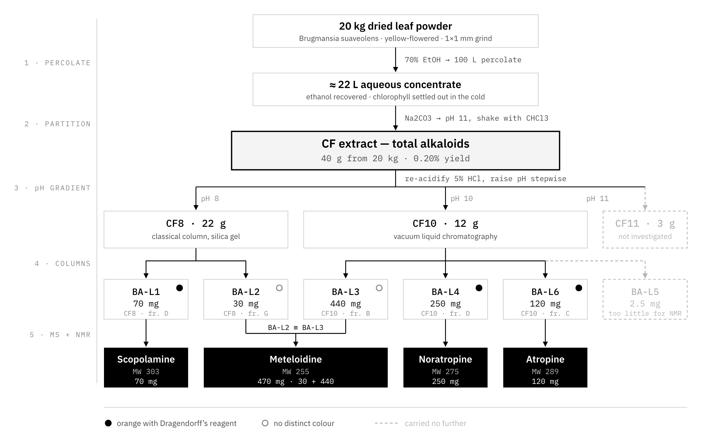

Before any of the machine learning, I spent many years on a bench in Ho Chi Minh City taking a
plant apart. This was my thesis for my Degree of Pharmacist at the University of Medicine
and Pharmacy, supervised by Dr. Nguyen Viet Kinh and Mr. Nguyen Manh Tin Tin. I want to write it down properly, partly
because it is the work I am still most fond of, and partly because the reasoning in it —
find the one step that makes everything downstream easier — turned out to be the same
reasoning I use now on entirely different problems.

The full thesis with all figures, tables and spectra is on ResearchGate: [*Studies on chemical constituents from Angel's trumpet
leaves* (Folium Brugmansiae)](https://www.researchgate.net/publication/413567545_Studies_On_Chemical_Constituents_From_Angel's_Trumpet_Leaves_Folium_Brugmansiae). What follows is the short version.

## The question

*Brugmansia suaveolens*, angel's trumpet, is grown as an ornamental all over Vietnam. It is
a large, pleasant, drooping-flowered shrub that people plant next to their houses, and its
flowers and leaves have been eaten — sometimes deliberately, sometimes not. The poisonings
that follow have a particular character: dry mouth, dilated pupils, confusion, hallucination.
That is an anticholinergic syndrome, and it points at tropane alkaloids.

So there were two questions, one defensive and one opportunistic. Despite that people conducted
multiple studies on flower, the leaf had limited attention. What is actually in the
leaf that makes it poisonous? And given that whatever is in there is present in quantity,
could the leaf serve as a raw material for scopolamine?

## The material

Twenty kilograms of dried leaf, collected at Di Linh in Lâm Đồng in March 2014, from the
yellow-flowered variety, ground to about 1×1 mm.

## The separation

The whole scheme is below. It is worth reading before the commentary.

Percolation with 100 L of 70% ethanol, then the ethanol recovered and the concentrate left
in the cold so the chlorophyll would settle out — roughly 22 L of aqueous concentrate.
Basifying that to pH 11 with Na2CO3 and shaking against chloroform
gave **40 g of total alkaloid extract from 20 kg of leaf, a 0.20% yield**.

Then the step the rest of the work rests on. Rather than take 40 g of mixed alkaloids
straight onto a column, I re-acidified with 5% HCl and raised the pH back up in stages,
extracting at each stop:

| Fraction | pH | Mass | Then |
|:--|:--|:--|:--|
| CF8 | 8 | 22 g | classical silica-gel column |
| CF10 | 10 | 12 g | vacuum liquid chromatography |
| CF11 | 11 | 3 g | not investigated |

Alkaloids differ in basicity, so they cross back into the organic phase at different pH.
Sorting them that way first means each fraction going onto a column already has one
predominant compound in it, and the chromatography has far less to do. This is the pivot of
the thesis: a cheap, low-tech separation placed before the expensive one, so the expensive
one becomes easy.

Six isolates came off the columns. Two of them, BA-L2 from CF8 and BA-L3 from CF10, turned
out by TLC and NMR to be the same substance appearing in both fractions — 30 mg and 440 mg
of the same compound.

## The four compounds

Structures were assigned from MS together with 1H, 13C, DEPT, HSQC and
HMBC, run on a Bruker Avance 500 at the Institute of Chemistry, Vietnam Academy of Science
and Technology in Hanoi.

| Code | Compound | Formula | MW | Isolated |
|:--|:--|:--|--:|--:|
| BA-L1 | Scopolamine | C17H21NO4 | 303 | 70 mg |
| BA-L2 / L3 | Meteloidine | C13H21NO4 | 255 | 470 mg |
| BA-L4 | Noratropine | C16H21NO3 | 275 | 250 mg |
| BA-L6 | Atropine | C17H23NO3 | 289 | 120 mg |
| BA-L5 | not determined | — | — | 2.5 mg |

All four share the tropane skeleton.

## What it established

**The leaf is not incidentally toxic.** Three of the four identified compounds — atropine,
scopolamine, noratropine — are anticholinergic tropane alkaloids, and they are there in
quantity. The reported poisonings are exactly what you would predict from this composition.
That is the answer to the defensive question, and it argues for public awareness about a
plant most people treat as decoration.

**The pH-gradient partition is transferable.** Partitioning at pH 8, 10 and 11 before
chromatography should work on other Vietnamese Solanaceae carrying this compound class.

**Four reference NMR profiles**, usable in reference-substance documentation for testing
raw material and finished products.

**A supply signal.** Recovery is high enough that the leaf is worth evaluating seriously as
a source of scopolamine and hyoscyamine.

## What I left open

The honest part of any thesis is the list of things you ran out of time for.

The **3 g of CF11** was never worked up, so the most basic alkaloids in the leaf remain
unmapped. The **70 mg scopolamine figure is a floor, not an estimate** — only 1 g of the
12.89 g of fraction D was ever converted to the salt, so the leaf holds considerably more
than that number suggests. **BA-L5** was 2.5 mg, too little to run NMR on. And I found
*Brugmansia versicolor* growing in Nghệ An, which deserves the same treatment and never
got it.

---

*Ngoc-Huy Pham. ["Studies on chemical constituents from Angel's trumpet leaves (Folium Brugmansiae)"](https://www.researchgate.net/publication/413567545_Studies_On_Chemical_Constituents_From_Angel's_Trumpet_Leaves_Folium_Brugmansiae). Thesis for the degree of Bachelor of Pharmacy, University of Medicine and Pharmacy at Ho Chi Minh City, 2015–2016. Supervisor: Viet-Kinh Nguyen, PhD. Spectroscopy performed at the Institute of Chemistry, Vietnam Academy of Science and Technology, Hanoi.*
