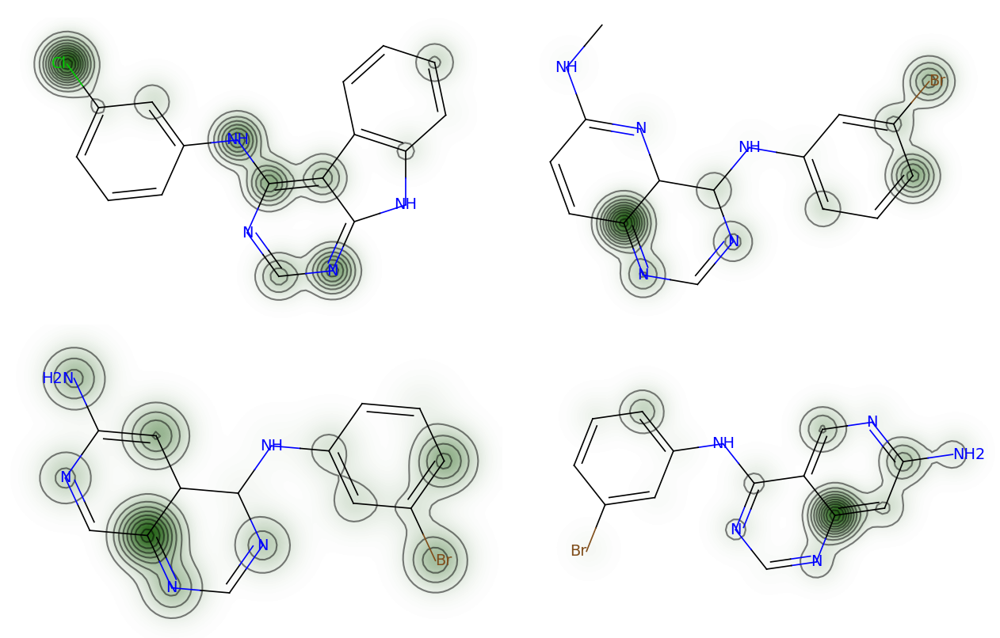

A few years after the [Angel's trumpet work](),
I was doing the same kind of question — which molecules are active, and why — with a GPU instead of
a separatory funnel. This post introduces the paper I wrote with
[Trung Hoang Le](https://www.linkedin.com/in/trung-hoang-le):
[*Attention-based Multi-Input Deep Learning Architecture for Biological Activity Prediction: An Application in EGFR Inhibitors*](https://arxiv.org/abs/1906.05168)
published at the *2019 11th International Conference on Knowledge and Systems Engineering (KSE)*.
Code is at [lehgtrung/egfr-att](https://github.com/lehgtrung/egfr-att).

## The problem with training features separately

A molecule can be described two ways, and they carry different information.

You can describe its **structure** — the atoms, the bonds, the rings — usually as a fingerprint
vector or, as we did, straight from the SMILES string. Or you can describe its **chemistry** —
logP, dipole moment, the thousand-odd computed molecular descriptors that summarise how the
whole molecule behaves.

Studies had already established that combining both helps. But the way it was done was: train
one model on structure, train a second model on descriptors, then feed both outputs into a third
model that makes the final call. That works, and it is also awkward. Every feature set needs its
own algorithm, so you cannot build one pipeline; you build three and hope they stay in sync.
The models never see each other during training.

Our question was simply: what if both go into one network, trained at once?

The second problem was interpretation. A neural network that says *0.87, inhibitor* and nothing
else is hard to use in medicinal chemistry, where the actionable question is which part of the
molecule you should keep and which part you should change.

## The architecture

Two branches meeting at a concatenation.

The **CNN branch** takes structure. Each SMILES string is encoded as a matrix using
M. Hirohara's scheme: one row per character, padded to 150 rows, and 42 features per row — 21
describing the atom (element, attached hydrogens, degree, charge, valence, ring membership,
aromaticity, chirality, hybridisation) and 21 describing SMILES syntax (brackets, bonds,
branch markers, start and end). That matrix goes through two convolution blocks — conv2d, batch
norm, dropout, max pool — and a linear layer.

The **MD branch** takes chemistry. 1613 two-dimensional descriptors computed with `mordred`,
cleaned of constant and meaningless columns, standard-scaled, then three fully connected blocks
narrowing 512 → 128 → 64.

The **attention layer** sits on the structural branch. Let $R_i$ be row $i$ of the SMILES
feature matrix — that is, one atom — and $\vec{m}$ the vector coming out of the CNN branch's
linear layer. The attention weight for that atom is the similarity between the two, squashed:

$$a_i = \frac{1}{1 + \exp(R_i \cdot \vec{m})}$$

and the layer's output is the weighted sum $\vec{f} = \sum_i a_i R_i$.

The point is that $a_i$ is a number attached to a specific atom. You can read it off after
training and ask the model which atoms it was looking at.

Then $\vec{f}$, $\vec{m}$ and the descriptor vector $\vec{t}$ are concatenated, passed
through one linear layer, and squashed by a sigmoid into the probability that the compound
inhibits EGFR.

## The data

EGFR — the epidermal growth factor receptor — is a tyrosine kinase whose dysregulation drives
several cancers, lung cancer especially, which makes it one of the most-studied targets in
oncology.

We used H. Singh et al.'s dataset: 3492 compounds labelled inhibitor or non-inhibitor at an
IC50 threshold of 10 nM. The ratio is 506 inhibitors to 2986 non-inhibitors, about
1 : 6, so the class imbalance is real and the metric choice matters. Singh's Random Forest model
on the same data is the baseline we had to beat.

Everything was implemented in PyTorch, tuned by grid search, and evaluated by 5-fold
cross-validation with early stopping at 30 epochs of rising loss. The winning configuration:
batch size 128, dropout 0.5, ADAM, learning rate 1e-5, decision threshold 0.2.

## Results

We report MCC as the primary metric. Accuracy and F1 both ignore parts of the confusion matrix,
and on a 1 : 6 split that is how you fool yourself; MCC uses all four cells.

| Metric | H. Singh et al. | CNN only | CNN + MD | CNN + MD + ATT |
|:--|--:|--:|--:|--:|
| Sensitivity | 69.89% | 74.31% | 75.29% | 74.11% |
| Specificity | 86.03% | 85.77% | 89.75% | **90.15%** |
| Accuracy | 83.66% | 84.10% | 87.66% | **87.83%** |
| MCC | 0.49 | 0.50 | **0.58** | 0.57 |
| AUC | 89.00% | 87.52% | 90.32% | **90.84%** |
| Loss | — | 0.2727 | 0.2434 | **0.2399** |
| Running time | — | 59 min | **31 min** | 37 min |

Three things in that table are worth pulling out.

**Structure alone is not enough.** The CNN-only model barely matches the Random Forest baseline
and is actually worse on AUC. Our reading is sparsity: padding every SMILES string out to 150
rows leaves a mostly-empty matrix, and a sparse input needs more data than 3492 compounds to
train on.

**Adding the descriptor branch fixes it.** MCC goes 0.50 → 0.58, AUC 87.5% → 90.3%. The second
input gives the network information it can use immediately, rather than having to extract it
from a sparse matrix.

**And it trains faster.** The bigger model takes *half* the time of the small one — 31 minutes
against 59. The sparse-input model needs many more epochs to converge; when the descriptor
branch is there, information appears to flow between the branches and the loss settles much
sooner. That was the result that surprised us most, and it is exactly what the
train-each-feature-set-separately approach throws away.

## What the model looks at

Attention weights, one per atom, rendered over the structure with `rdkit`. Darker means the
model weighted that atom more heavily.

Two patterns show up across compounds: **nitrogens in heterocyclic rings** are consistently
highlighted, and **halobenzyl substitution on a heterocycle** contributes positively to
predicted activity. Both are recognisable to anyone who has looked at this chemical series —
which is the point. The model is not being asked to teach us new pharmacology here; it is being
asked to show that its confidence rests on the parts of the molecule that ought to matter.

Note that attention cost us nothing on MCC (0.58 → 0.57) and gained a little on AUC and
specificity. We did not tune the attention model hard, because interpretability was what we
wanted from it.

## Limitations

**Attention is per-atom, so functional groups are invisible.** Each row of the feature matrix is
one atom, weighted independently. A carbonyl or a carboxylic acid is a unit chemically, but the
model has no way to say so. The fix we proposed is a third branch embedding substructure
patterns — ECFP, or a hashed fingerprint — so groups can carry weight as groups.

**The dataset is small for deep learning.** 3492 compounds, and the CNN-only result shows what
that costs when the input is sparse.

**Attention did not improve accuracy.** It bought interpretation, not performance. Whether
tuning it properly would change that, we did not find out.

---

*Huy Ngoc Pham, Trung Hoang Le. ["Attention-based Multi-Input Deep Learning Architecture for
Biological Activity Prediction: An Application in EGFR Inhibitors"](https://arxiv.org/abs/1906.05168).
In 2019 11th International Conference on Knowledge and Systems Engineering (KSE), IEEE, 2019.
Preprint: arXiv:1906.05168. Figures reproduced from the paper. Implementation:
[github.com/lehgtrung/egfr-att](https://github.com/lehgtrung/egfr-att).*
